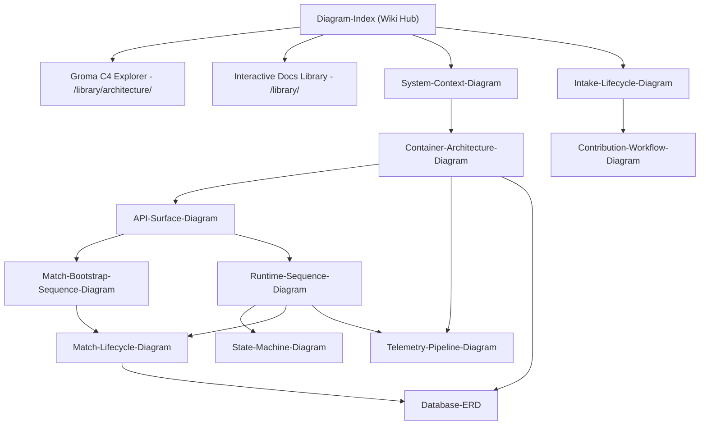

# Part 3: Living Architecture: Diagrams, C4 & Freshness Gates

*By [Mike Hall](https://www.just3ws.com/) · Canonical edition on `phalanxduel.com` · Companion Panoramic View essay on [just3ws.com](https://www.just3ws.com/2026/11/26/phalanx-duel-series-part-3-living-architecture-and-diagrams.html) · Engine `v1.6.0`*

Architecture diagrams usually rot the week after they are drawn. A diagram that claims a retired vendor is still in production - or still labels routes `v1.0` when the server is on `v1.6.0` - is worse than no diagram at all because it misleads the next engineer with confidence.

Phalanx Duel solves diagram drift with a **two-tier architecture surface**:

1. **Auto-generated live views** built directly from repository code and synced to `phalanxduel.com`:
   - **[Interactive Groma C4 Architecture Map](/library/architecture/)** - Drill-down C4 explorer across system context, containers, and components.
   - **[Interactive Documentation & Visual Library](/library/)** - Live SPA covering the Database ERD, System Topology, Package DAG, Fastify API Directory, and audience overviews.
2. **12 curated GitHub Wiki diagrams** mapped in a [Meta-Diagram on `Diagram-Index`](https://github.com/phalanxduel/phalanxduel/wiki/Diagram-Index), each pinned to an exact release version and a 90-day reconfirmation date.

## The Meta-Diagram (Map of Diagrams)



## Version Mapping & 90-Day Reconfirmation Enforcement

Every curated wiki diagram carries three machine-parsed header lines:

```text
Applies to version: v1.6.0
Last verified: 2026-11-26
Reconfirm by: 2027-02-24
```

The zero-dependency checker `./bin/check-diagram-freshness` in the wiki repository reads `../game/package.json`, compares every diagram's `Applies to version:` against the live release, and fails non-zero if any diagram is missing metadata, version-drifted, or past its `Reconfirm by:` date.

## Watch Architecture & Verification in Action

- **[Reading the HUD, Combat Math Inspector & Narration Settings](https://youtu.be/b5JYEdbTmlw)** (Ep. 08) - How engine combat math projects cleanly to the UI.
- **[Deterministic Replays & Cryptographic Hash-Chain Verification](https://youtu.be/U1u8AwF_OmI)** (Ep. 15) - Proving every turn state hash against the append-only ledger.
- **[Spectator Mode: Watch Links, Delay & Fair-Play Redaction](https://youtu.be/yg8-nTqxdd8)** (Ep. 16) - Server-side viewer projection enforcing Fog of War.

## Canonical Sources & Attribution

- **Live Architecture:** [Visual Library](/library/) · [Groma C4 Map](/library/architecture/) · [Technical Details](/technical-details/)
- **Wiki Diagrams:** [Diagram Index](https://github.com/phalanxduel/phalanxduel/wiki/Diagram-Index) · [API Surface](https://github.com/phalanxduel/phalanxduel/wiki/API-Surface-Diagram) · [Database ERD](https://github.com/phalanxduel/phalanxduel/wiki/Database-ERD) · [Telemetry Pipeline](https://github.com/phalanxduel/phalanxduel/wiki/Telemetry-Pipeline-Diagram)

---

**Series Navigation:** [← Part 2: Rules & Combat Cascade](/articles/rules-and-combat-cascade/) · **Part 3 (Current)** · [Next: Part 4 - The Engineering Process →](/articles/engineering-process/)
