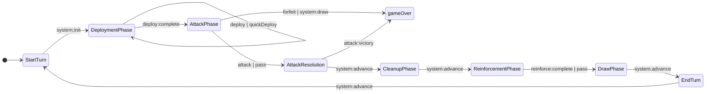

# Part 2: Canonical Rules v3.0 & The Combat Cascade

*By [Mike Hall](https://www.just3ws.com/) · Canonical edition on `phalanxduel.com` · Companion breakdown on [just3ws.com](https://www.just3ws.com/2026/11/26/phalanx-duel-series-part-2-rules-and-combat-cascade.html) · Engine `v1.6.0` / Rules `v3.0`*

Ambiguous prose is where tabletop rules break down. In Phalanx Duel, the normative rules in [`docs/gameplay/rules.md`](https://github.com/phalanxduel/phalanxduel/blob/main/docs/gameplay/rules.md) are backed 1:1 by an executable TypeScript state machine in [`engine/src/state-machine.ts`](https://github.com/phalanxduel/phalanxduel/blob/main/engine/src/state-machine.ts) and verified by property and transition tests.

## The Canonical 8-Phase State Machine

Every turn moves through an explicit, server-enforced phase graph:

See the full annotated graph on the [State Machine Diagram wiki page](https://github.com/phalanxduel/phalanxduel/wiki/State-Machine-Diagram).

## Column Overkill & The Four Suit Boundaries

When a front-rank attacker strikes the opposing column, damage resolves sequentially across three targets: **Opposing Front Card → Opposing Back Card → Opponent Life Points**. Suit effects trigger strictly at the boundaries between those targets:

| Suit | Role | Boundary Trigger | Tactical Consequence |
| --- | --- | --- | --- |
| **Diamonds (`♦`)** | Front-to-Back Shield | Defender's front card absorbs incoming damage | Reduces or blocks carryover damage before it reaches the back rank. |
| **Clubs (`♣`)** | Overflow Multiplier | Attacker punches through a defending card | Doubles eligible overflow damage spilling deeper into the column. |
| **Hearts (`♥`)** | Life-Point Shield | Excess damage crosses from the column toward Life Points | Cushions direct damage to the defending player's Life Points. |
| **Spades (`♠`)** | Lethal Finisher | Unblocked damage reaches opponent Life Points | Doubles damage delivered directly to enemy Life Points. |

Test any exact matchup interactively in the [Combat Lab (Battle Calculator)](/tools/battle-calculator/) or review the [Suit Boundaries Mastery Guide](/mastery/mastery/).

## Classic vs. Cumulative Modes & Pass Economy

- **Classic Mode (Default):** Surviving cards reset damage between turns - creating crisp per-turn arithmetic and rewarding high-burst column breaks.
- **Cumulative Mode:** Damage persists on surviving cards across turns - turning chip damage into attrition traps.
- **Pass & Liveness Policy:** Passing preserves formation tempo, but consecutive passes are bounded by the canonical turn-boundary liveness rule (`system:draw`) so matches cannot stall indefinitely.

## Watch the Rules & Strategy Videos

- **[Formation-First Deployment & Quick Deploy](/learn/tutorials/#season-1)** (Ep. 02 - queued for publication)
- **[Combat Cascade & Column Overkill Explained](https://youtu.be/cIgBZrdDVE0)** (Ep. 03)
- **[Suit Boundaries in Combat](https://youtu.be/9gJ-stFf0O8)** (Ep. 04)
- **[Passing and Reinforcing in Phalanx Duel](https://youtu.be/199z_P2031Q)** (Ep. 05)
- **[Classic vs Cumulative Damage Modes](https://youtu.be/4x4c_e0p10I)** (Ep. 09)
- **[Read a Column Before You Attack](/learn/tutorials/#season-6)** (Ep. 20 - queued for publication)
- **[Pass a Turn and Read the Reply](/learn/tutorials/#season-6)** (Ep. 21 - queued for publication)

## Canonical Sources & Attribution

- **Rules Reference:** [Canonical Rules](/learn/rules/) · [Quick Players Guide](/guide) · [`engine/src/state-machine.ts`](https://github.com/phalanxduel/phalanxduel/blob/main/engine/src/state-machine.ts) · [`engine/src/turns.ts`](https://github.com/phalanxduel/phalanxduel/blob/main/engine/src/turns.ts)

---

**Series Navigation:** [← Part 1: Game & Concepts](/articles/what-is-phalanx-duel/) · **Part 2 (Current)** · [Next: Part 3 - Living Architecture & Diagrams →](/articles/living-architecture-and-diagrams/)
